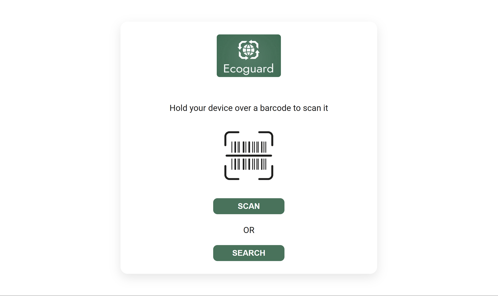

# EcoGuard 🌱

## About the App

EcoGuard is an app that provides a solution to combat greenwashing. Just scan a product's barcode or simply type in a company name, and our app will provide:

✅ Basic company & product info  
♻️ A sustainability score  
🚨 Warnings for potential greenwashing and a report



**NOTE: Doesn't include the ML model or website scraper**

## Installation

1. Clone git repository
```
git clone <repository-url>
```

2. Create virtual environment
```
python -m venv venv

# Activate it
  On macOS/Linux:
    source venv/bin/activate
  On Windows:
    venv\Scripts\activate
```
4. Install dependencies
```
pip install -r requirements.txt
```

5. Run the application
```
python app.py
```


